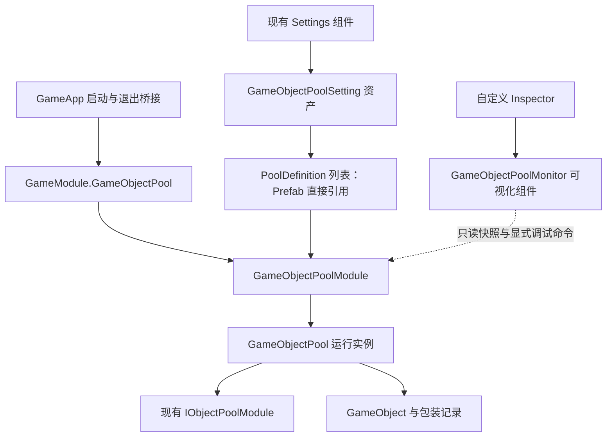

# GameObjectPool 模块改造方案

> **本方案已作废（2026-10-25）**：所描述的执行内容按用户决定全部归零，仅作历史记录。
> 当前分步文档见 [00-总览与设计基线](分步执行/00-总览与设计基线.md)：第 01—12 步为主功能，第 13—15 步为编辑器，第 16 步为按需验收。旧文中的类型选择、完成记录与执行顺序不作为当前实施依据；纯数据结构体规则以新总览第 10 节为准。

日期：2026-10-24  
状态：需求方向已澄清，方案待确认；尚未实施代码与资源修改。  
任务等级：L4 架构设计。本文中的类型、字段和 API 除明确标注为现状者外，均为拟议设计。

配套文档：[GitHub 十二项目调研](GameObjectPool-GitHub十二项目调研.md)、[分步执行与验收清单](GameObjectPool分步执行与验收清单.md)。

## 1. 已确认的目标与范围

1. 分析当前 `GameObjectPoolManager`，保留有用能力，解决生命周期和维护问题。
2. 移除对象池对 `ConfigSystem/TbPoolMap` 的依赖，使用 ScriptableObject 配置。
3. 遵循当前 `Settings → AudioSetting` 的组织方式，在 **Settings 组件上引用 GameObjectPoolSetting**。
4. **不通过 IResourceModule 加载池资源**。配置项直接拖入 Prefab，运行时实例化该引用。
5. 增加独立的 TEngine 游戏对象池模块，保留已有通用 `ObjectPoolModule`。
6. 挂在 GameObject 上的 Mono 用于**对象池可视化与调试操作**，不是模块 Driver；删除或禁用可视化组件不能改变池的运行。
7. 调研至少十个真正与 Unity 对象池相关的 GitHub 项目。本次纳入十二个独立项目，并读取每个项目的 README 和关键源码。
8. 本次交付分析、总方案和分步执行文档；不编写功能代码，不修改序列化资产，不运行编译、测试或 Play Mode。

此前提出的“资源地址 + IResourceModule 加载”和“Module + Driver 驱动生命周期”均不属于本方案。

## 2. 本地证据与实际边界

以下路径相对 Unity 项目根目录。

| 证据 | 已确认内容 |
|---|---|
| `ProjectSettings/ProjectVersion.txt` | Unity 2022.3.62f2 |
| `Packages/manifest.json` | URP 14.0.12；有 HybridCLR；已有 UniTask/YooAsset 相关代码 |
| `Assets/GameScripts/HotFix/GameLogic/Module/GameObjectPoolModule/` | 当前实现由 Manager、GameObjectPool、GameObjectInstance、PoolConfig 四个 C# 文件组成 |
| `Assets/TEngine/Runtime/Core/Module.cs`、`ModuleSystem.cs` | Module 是普通 C# 类；接口按命名约定解析实现；由 RootModule 统一调度；关闭顺序与优先级有关 |
| `Assets/TEngine/Runtime/Module/ObjectPoolModule/` | 已支持单次/多次借出、容量目标、过期回收、优先级、锁定和统计 |
| `Assets/TEngine/Runtime/Module/Settings/Settings.cs` | Settings 已持有 AudioSetting、ProcedureSetting、UpdateSetting 三个资产引用 |
| `Assets/TEngine/Runtime/Module/AudioModule/AudioSetting.cs` | 使用 CreateAssetMenu 创建 SO，保存音频组配置数组 |
| `Assets/TEngine/Settings/Prefab/GameEntry.prefab` | 实际存在 GameEntry/Settings、ResourceDriver 等节点；Settings 已绑定上述三个资产 |
| `Assets/GameScripts/HotFix/GameLogic/GameModule.cs` | 业务统一模块入口；目前没有游戏对象池属性 |
| `Assets/GameScripts/HotFix/GameLogic/GameApp.cs` | 热更入口已建立销毁回调；StartGameLogic 当前为空，Release 当前仅释放单例系统 |
| `Assets/TEngine/Runtime/Module/RootModule.cs` | OnDestroy 仅在非 Editor 分支调用 ModuleSystem.Shutdown，不能直接假设编辑器退出会清理新模块 |
| `ProjectSettings/EditorSettings.asset` | 当前未开启自定义 Enter Play Mode Options；禁用 Domain Reload 属额外兼容场景 |

在本次检索的业务源码中，没有找到这四个文件之外对 `GameObjectPoolManager` 的调用；未发现已生成的 `TbPoolMap` 定义，仅看到 Manager 中的访问和仓库 ConfigSystem 模板。**这是检索范围内的观察，不等于编译结果，也不证明外部程序集没有调用。**

新增的 `UnityProject/AGENTS.md` 已读取：方案存入 `Docx/架构设计/`，使用 tengine-dev 相关规范，并按 code-simplifier 只做本任务内的优化分析。用户明确指定的 Prefab 直接引用优先于通用资源加载规范；这是一项任务边界，不应推广成其他业务代码都绕过资源模块。

## 3. 当前对象池到底有哪些功能

| 功能 | 当前真实行为 | 改造方向 |
|---|---|---|
| 全局管理 | `Singleton<GameObjectPoolManager>`，首次访问创建常驻根节点 | 改为 `IGameObjectPoolModule` + ModuleSystem 管理 |
| 手动注册 | `CreatePool` 只保存 PoolConfig，未立即创建实际池 | 改名 RegisterPool，保留动态注册能力 |
| 表驱动懒创建 | TryGetPool 首次查 TbPoolMap，同步 LoadAsset，再创建池节点 | 从 SO 建索引；首次使用时创建池，无资源 IO |
| 底层池化 | GameObjectPool 用 `IObjectPool<GameObjectInstance>` 单次借出池 | 第一阶段继续复用 |
| 借出 | 六组位置/旋转/父节点重载，均有泛型组件版本 | 薄重载转发单一实现，明确坐标空间 |
| 空闲不足扩容 | 没有空闲包装对象时 Instantiate Prefab | 保留；增加可选硬上限 |
| 回收 | 根据实例映射找到池，改父节点，Unspawn | 保留；增加状态与租约约束 |
| 激活状态 | 包装对象 OnSpawn 激活，OnUnspawn 禁用并复位世界位置/旋转 | 调整顺序；统一首次与复用路径 |
| 延迟回收 | UniTask.Delay，支持外部取消和 Action 回调 | 保留能力，补足本次借出有效性和内部取消 |
| 清理策略 | 转发底层容量、自动释放间隔、过期时间、池优先级 | 保留并解释参数真实语义 |
| 查询 | HasPool、GetPoolByName、GetPoolByClone、IsClone | 拆分配置存在、池已创建、实例归属、当前借出状态 |
| 单池销毁 | 先移除配置，再销毁底层池与节点 | 明确强制销毁与只清空空闲对象的区别 |
| 全局释放 | 遍历池，清理名称映射、实例映射和根节点 | 移入幂等 Shutdown，覆盖编辑器退出路径 |

特别注意：底层 `DestroyObjectPool` 最终会遍历并释放池内全部对象，包含仍借出的对象。当前 `ReleasePool` 不能描述为“只释放闲置实例”。

## 4. 问题与优化优先级

这些结论来自静态代码阅读，未做运行复现。

| 优先级 | 问题与依据 | 影响 | 方案 |
|---|---|---|---|
| 必须 | DelayDespawn 只检查 GameObject 是否被销毁 | A 的旧定时任务可能回收已被重新借出的同一实例 | 每次借出生成 LeaseVersion；延时必须匹配池世代、实例记录、本次租约、任务版本 |
| 必须 | ReleasePool 不清理 `_objectPools` 中该池的记录 | 销毁后查询和回收仍可能命中已释放池 | 所有销毁统一经过注销路径；先删除索引再 Destroy |
| 必须 | 当前 `Spawn<T>` 在缺组件时返回 null，但已借出的对象未归还 | 调用方拿不到对象，池中仍记录正在使用 | 在激活前检查组件，失败立即回滚借出 |
| 必须 | GameObjectInstance.OnSpawn 在 DefaultSpawn 修改 Transform 前激活 | OnEnable 读取旧父节点和旧位置；首次 Instantiate 也可能提前激活 | 在非激活容器中创建，完成上下文和状态登记后再激活 |
| 必须 | GameObjectInstance 未 override Clear | MemoryPool 复用期间残留自己的 GameObject 引用和初始化标记 | 调用 base.Clear，再清空全部派生字段 |
| 必须 | 缺少外部 Destroy/场景卸载后的失效登记策略 | 可能重新借到已销毁对象、统计失真 | 销毁通知队列 + 借出前失效清理；不只依赖 OnDestroy |
| 必须 | 参数校验主要置于 UNITY_EDITOR | Player 中空配置、非法数量可能走入不合法状态 | 编辑器提示与运行时入口校验；避免层层重复检查 |
| 必须 | IsCreating 实际表示已创建，而非正在创建；配置混入运行状态 | 难以正确维护初始化、预热与关闭状态 | SO 只存配置；运行态独立，字典决定是否存在池 |
| 必须 | Shutdown 不在模块链内；退出依赖单例 | 模块化后原清理链不再自动成立 | 显式启动和幂等关闭；退出业务桥接，不依赖 Monitor |
| 应做 | `_objectPools` 只记录借出中的对象 | IsClone 对池内空闲对象返回 false，名称与含义不符 | 所有受管实例登记，另记录是否借出 |
| 应做 | GetPoolByName 会隐式创建池、甚至加载资源 | “查看”操作改变运行状态 | TryGetPoolInfo 只读；TryGetPoolOrCreate 单独创建 |
| 应做 | `localPosition/localRotation` 被用于所有位置重载 | 世界坐标调用容易误用，缩放也没有恢复 | Spawn 默认世界坐标，SpawnLocal 明确局部坐标；恢复 Prefab 初始 localScale |
| 应做 | 池名使用 Mono 的 name，而非配置的 PoolName | 管理名称与底层统计名称不一致 | 明确传 PoolName，节点显示名称不充当键 |
| 应做 | GetHashCode 与 GetInstanceID 混用 | 身份表达不统一 | 统一 GetInstanceID；不能据此断言当前 Unity 的两个返回值一定不同 |
| 应做 | 大量相同重载和逐行翻译式注释 | 维护成本高，语义说明反而不足 | 只保留薄重载；注释解释坐标、所有权、回调顺序和失败语义 |
| 后续评估 | 底层 TrySpawn 遍历同名对象范围 | 大量活跃实例时，寻找空闲对象可能线性扫描 | 第一阶段不重写通用池；以后用实际 Profiler 数据决定是否单独优化 |

当前同步 LoadAsset 没有在释放池时配对 UnloadAsset，属于现状问题；按已确认的新方案直接移除这条资源加载链，不增加新的资源句柄管理。

## 5. 目标架构：配置、运行、可视化分开



### 5.1 类的职责

| 拟议类型 | 职责 | 明确不负责 |
|---|---|---|
| `GameObjectPoolSetting : ScriptableObject` | 保存可序列化的配置数组和预热预算 | 不保存实例字典、运行计数或取消源；不在 OnEnable 自动建池 |
| `GameObjectPoolDefinition` | 单池名称、Prefab、容量和回收参数 | 不保存 IsCreating、Transform 或运行时池引用 |
| `IGameObjectPoolModule` | 业务调用契约 | 不暴露内部可变集合 |
| `GameObjectPoolModule : Module` | 配置快照、注册、索引、延时任务、统一关闭 | 不绘制 GUI，不加载 YooAsset |
| `GameObjectPool`（普通 C# 类） | 单种 Prefab 的实例生命周期及底层池适配 | 不需要为每个池挂一个 Mono 来执行 Update |
| `GameObjectInstance : ObjectBase` | 底层包装、实际销毁回调、Clear | 不提前激活对象，不直接驱动业务流程 |
| ~~`PooledGameObject : MonoBehaviour`~~ | ~~每个克隆的归属标记、缓存回调组件、提供销毁通知~~ **（2026-10-25 20:20 删除，方案作废）** | 不每帧 Update、不自建池；与可视化 Monitor 是不同角色 |
| `GameObjectPoolMonitor : MonoBehaviour` | 挂载的可视化入口、展示设置、只读查询和显式命令转发 | 不初始化池，不驱动更新，不在 OnDestroy 关闭池 |
| `GameObjectPoolSettingInspector` | 编辑配置、逐项问题提示、Prefab 定位 | 不实例化场景对象 |
| `GameObjectPoolMonitorInspector` | 查看运行状态、实例定位、手动清理等操作 | 不修改 SO 运行数据，不因绘制创建模块 |

这体现职责拆分、依赖倒置和组合复用。采用一个公共模块接口、一个轻量回调接口即可，不额外设计通用 Provider、DI 容器或插件系统。

### 5.2 TEngine 集成

- 框架实现、接口、SO 类型放在 `TEngine.Runtime`；编辑器代码放在 `TEngine.Editor`。
- 接口和实现使用同命名空间、同程序集的 `IGameObjectPoolModule / GameObjectPoolModule`，匹配 ModuleSystem 的反射命名规则。
- 业务通过 `GameModule.GameObjectPool` 调用。框架内部获取自己的依赖时使用 ModuleSystem，不能让 TEngine.Runtime 反向引用热更层的 GameModule。
- `OnInit` 只绑定框架依赖，`Initialize(Settings.GameObjectPoolSetting)` 才构造配置快照和根节点。Initialize 在 GameApp.StartGameLogic 中调用，Monitor 完全不参与。
- 模块优先级建议为 5，低于现有 ObjectPoolModule 的 6，使新模块先关闭、底层池后关闭；这是模块生命周期优先级，不是单个池的回收优先级。
- `Shutdown` 幂等。Player 可由 ModuleSystem 关闭；GameApp 的退出桥接覆盖当前 Editor 未执行 RootModule.Shutdown 的情况，不重复构造模块。
- 新增只读 `ModuleSystem.TryGetModule<T>(out T)`，兼容现有接口键/实现类型键查找，但不创建模块、不注册、不执行 OnInit。Monitor 用它显示“尚未初始化”，避免 Inspector 打开时悄悄启动池。
- 只为失效对象清理等确有需要的工作接入 IUpdateModule；复用底层自动过期清理，不能再让 Monitor 或每个池重复驱动它。

## 6. ScriptableObject 如何替代 TbPoolMap

### 6.1 挂载方式

沿用 Settings 已有模式，增加如下成员；这里只展示设计伪代码，不是已修改代码：

```csharp
[SerializeField]
private GameObjectPoolSetting gameObjectPoolSetting;

public static GameObjectPoolSetting GameObjectPoolSetting
{
    get { return Instance.gameObjectPoolSetting; }
}
```

资产创建菜单拟为 `TEngine/GameObjectPoolSetting`。资产建议放在 `Assets/GameSettings/GameObjectPoolSetting.asset`，项目配置不放进将被框架更新覆盖的框架目录。

用法是：选中 **GameEntry/Settings** → 找到 **Game Object Pool Setting** → 拖入 SO → 在 SO 条目中直接拖入 Prefab。不是把 SO 本身当作 MonoBehaviour Add Component。

### 6.2 字段定义

| 字段 | 含义与约束 | 初始建议 |
|---|---|---|
| `PoolName` | 非空、大小写敏感的稳定逻辑名，不随 Prefab 重命名自动变更 | 手动填写，如 Coin |
| `Prefab` | GameObject Prefab 资产引用，不允许场景实例 | 必填 |
| `PrewarmCount` | 初始化预热目标总量；0 表示不预热 | 0，按场景需求调整 |
| `Capacity` | 保留 TEngine 底层语义：总数超过该目标时尝试释放空闲对象；不是实例硬上限，也不是最小保有量 | 可给编辑器初值 32，不视为调优结论 |
| `MaxInstanceCount` | 可选实例总量硬上限；0 为不限制；达到上限且无空闲实例时 TrySpawn 返回 false | 0 |
| `AutoReleaseInterval` | 底层清理检查间隔，必须大于 0；采用真实流逝时间 | 60 秒示例值 |
| `ExpireTime` | 空闲实例过期时间，必须大于 0；预热数量不会永久锁定 | 60 秒示例值 |
| `Priority` | 沿用底层池级回收排序；不是禁止销毁标记，也不是实例抢占规则 | 0 |
| `PrewarmPerFrame`（Setting 级） | 分帧预热每帧最多创建数量，必须大于 0 | 4 个示例值；不能保证某个毫秒预算 |

初始化拒绝重名、空 Prefab、负数量、非有限时间值和 `PrewarmCount > MaxInstanceCount > 0` 等矛盾配置。`PrewarmCount > Capacity` 提示可能很快清理；不默默修改用户数值。未配置任何池是合法空设置，缺少 Setting 资产则明确报告初始化失败。

配置在启动时复制到运行时定义中，之后修改 SO 不自动影响已建池。第一阶段 Play Mode 中禁用资产编辑；不提供“运行时改配置并自动写回资产”。

### 6.3 替换入口

```text
原路径：TryGetPool → TbPoolMap → 同步 LoadAsset → CreatePool

新路径：
Initialize(setting)
    一次性校验并复制 definition[] → Dictionary<PoolName, RuntimeDefinition>

TryGetPoolOrCreate(poolName, out pool) -> bool
    若已创建 → 返回现有池
    若无定义 → 返回明确失败
    用 definition.Prefab 创建运行池
    发布到 _pools（全部成功后才发布）
```

“懒创建”只表示暂不创建实例与运行池，**并不表示 Prefab 资源引用也延迟加载**。Settings 持有 SO，SO 又持有所有 Prefab；其依赖可能随资产加载进入内存并影响主包依赖。清理实例不会解除这条资产引用链，不调用 UnloadAsset，也不承诺资源内存立即回收。

## 7. 生命周期与 API 合同

### 7.1 借出与回收的顺序

> **本节已被取代（2026-10-25 16:50）**：下文「Active 根 + 不激活的 Inactive 根」两层容器不再采用。现行结构是 `[GameObjectPool]` 根下按池各挂一个同名子节点，实例（空闲与已借出）默认都留在自己的池节点下，空闲实例只做自身 `SetActive(false)`。以下伪代码里所有 `ActiveRoot` / `InactiveRoot` 对应位置应读作"池节点"，`SetParent(parent ?? ActiveRoot)` 读作"仅当调用方给了 parent 才换父"。现行规格以 `分步执行/` 目录为准。

模块根节点建议独立创建为常驻的 `[GameObjectPool]`，内部有激活的 Active 根和不激活的 Inactive 根。它不依赖 Monitor 是否存在。

```text
Spawn：
  检查模块状态 → 找到/创建池
  尝试借出空闲包装对象；没有则检查硬上限后创建
  新对象在 Inactive 根下 Instantiate，随后先设 activeSelf=false
  泛型组件检查；失败走回滚，不留下借出实例
  写入实例归属、借出状态、递增租约
  SetParent(parent ?? ActiveRoot, false)
  写入世界/局部坐标，恢复 Prefab 的初始 localScale
  调用 OnPoolSpawn(context) 进行每次借出准备
  SetActive(true)
  返回对象

Despawn：
  验证归属、租约、占用标志 → 立归还中标记，阻止重复/重入回收
  取消本次延时任务
  调用 OnPoolDespawn → SetActive(false)
  SetParent(InactiveRoot, false)，恢复局部变换
  底层 Unspawn → 状态 Idle
```

底层 `GameObjectInstance.OnSpawn/OnUnspawn` 不再承担 SetActive，由上层统一安排。首次创建和复用走相同的业务回调流程，预热不伪造一次借出/回收。借出扩容直接以 `Register(record, true)` 注册为占用，避免超过 Capacity 时被立即清理；预热仍注册为空闲。

建议轻量接口 `IGameObjectPoolCallbacks` 提供 `OnPoolSpawn(context)` 与 `OnPoolDespawn()`，根及子节点上的实现只在实例创建时缓存一次。业务负责速度、粒子、Trail、事件、协程之外的异步任务等状态复位；核心模块不扫描并猜测所有组件的重置方式。

由于对象在 inactive 层级创建，首次准备回调不能依赖 Awake/Start 已经执行；回调实现应使用序列化引用或显式初始化。OnEnable 可以读取已设置的 Transform。回调异常仅在需要回滚状态的边界处理，带池名记录上下文并向调用方暴露失败，不能吞掉所有异常后返回“成功”。在借出准备回调中立即回收自身属于不支持的重入，需要给出诊断；不允许残缺记录进入可用池。准备失败时，对已经进入的准备回调调用配对清理（此时可能尚未激活），随后丢弃失败实例；业务清理必须兼容部分初始化。OnEnable 中若已归还、再次借出或释放池，原 Spawn 返回失败，不返回新租约对象。

### 7.2 建议对外接口

| API | 明确语义 |
|---|---|
| `Initialize(setting)` | 只初始化配置/根节点，重复相同初始化不重复注册 |
| `RegisterPool(definition)` | 动态注册配置；不立即创建实例，不允许静默覆盖同名池 |
| `Spawn / Spawn<T>` | 同步实例复用/实例化，不做资源 IO；失败返回 null 并有诊断 |
| `TrySpawn(..., out instance)` | 无配置/达到硬上限等预期失败返回 false；泛型缺组件回滚 |
| `SpawnLocal(...)` | 显式局部位置/旋转；与 Spawn 的世界坐标合同分开 |
| `Despawn(instance)` / `TryDespawn(instance)` | 只回收本模块当前借出的实例；外部对象不擅自 Destroy |
| `Despawn(instance, delay, callback, token)` | 保留现有延迟与回调能力，但绑定调用时的租约 |
| `CancelDelayedDespawn(instance)` | 取消这次延迟计划，不回收对象 |
| `PrewarmAsync(poolName, targetTotal, token)` | 补到目标总量而非每次追加，按每帧数量分摊 Instantiate |
| `ClearUnused(poolName)` | 只清空闲实例；配置与借出实例保留 |
| `ReleasePool(poolName, force=false)` | 默认在存在借出实例时拒绝；force 明确销毁全部实例；定义保留，可重建 |
| `UnregisterPool(poolName, force=false)` | 撤下运行时定义后关闭运行池，释放被拒绝则恢复定义；避免预热完成通知重入建池，SO 不被修改 |
| `ContainsDefinition / HasPool` | 分别表示已注册定义/已创建运行池，不触发创建 |
| `IsManaged / IsSpawned` | 分别表示本模块拥有/当前正在借出 |
| `TryGetPoolInfo / FillPoolInfos / FillInstanceInfos` | 只读快照，允许调用方复用 List，不暴露底层可变集合 |
| `Shutdown()` | 先阻止新请求，取消任务、清实例/池/索引/引用/根；可重复调用 |

原 API 的世界/局部坐标、ReleasePool 同时删定义、IsClone 等语义将发生变化，应作为显式迁移项处理，而不是以“重构”名义静默改变调用方行为。当前未找到外部调用，因此建议直接迁移；只有实际找到外部依赖时才保留临时适配器。

### 7.3 延迟回收的关键保护

```text
计划延迟回收时：
  捕获 record 身份 + PoolGeneration + LeaseVersion + RequestVersion
  同一租约已有计划 → 取消旧计划，以最新计划为准
  组合调用方取消与本次计划取消（仅有延时需求时分配）

等待结束后：
  检查取消、模块/池状态、记录是否仍属原池、租约和任务版本
  全部匹配才尝试归还
  成功才通知 callback；取消、已回收、池关闭均不通知成功

立即回收、销毁、ReleasePool、Shutdown：
  取消对应计划，使旧计划无法命中新租约
```

保留 UniTask.Delay 的简单实现，取消异常按正常结果处理；日志不得在取消后访问已销毁对象的 name。`Action<GameObject>` 兼容回调只用于成功通知，不转移对象所有权，不能持有它继续执行延迟修改；有强异步所有权需求时，再增加公开的值类型租约句柄。

这一方案不宣称延时零分配。现有 TimerModule 的 AddTimer 也会创建 Timer，params 参数可能分配；不能未经测量就声称替换成 Timer 必然更快。统一定时队列作为后续优化，不在第一阶段再造调度器。

### 7.4 外部销毁、场景切换与预热

- 模块记录全部实例，用 `IsSpawned` 区分借出与空闲（`PooledInstanceState` 枚举已于 2026-10-25 18:10 删除），所有移除都从同一个入口清除反向映射和计数。
- ~~`PooledGameObject.OnDestroy` 只提交通知；在安全时点清理底层记录，避免在底层集合遍历时重入修改。~~ **（2026-10-25 20:20 作废：标记组件已删，外部销毁不再通知池；池只在借出时绕开死引用。）**
- 对仍处于借出计数的失效包装对象，需要先按“失效对象路径”归还底层计数，再 ReleaseObject；此路径不得再操作已销毁 Transform 或调用业务回收回调。
- 从未激活的预热对象不能只靠 OnDestroy 保证通知；借出检查和清理路径也要剔除 Unity 已销毁对象。
- 绑定到业务父节点的对象随父节点/场景销毁时，作为外部销毁清账，不在 OnDestroy 中尝试重新挂父节点“救回”。业务需要保留时应在销毁父节点前主动 Despawn。
- 不传父节点的对象留在自己的池节点下，与模块根一同常驻；调用方必须在关卡结束时归还。第一阶段不自动猜测归属场景。
- 预热使用专门的“创建并注册空闲实例”路径，不能循环 Spawn/Despawn 同一个对象冒充预热 N 个。
- 通过模块现有 Update 推进预热，每帧重新检查运行池身份、关闭状态、取消和当前数量；并发请求合并为同池一个创建任务，各请求独立完成或取消；全模块共用 PrewarmPerFrame 预算。取消不自动销毁已经预热成功的实例。空闲目标超过底层 Capacity 或实例硬上限时告警并裁剪，避免无法保有的目标反复实例化。
- 预热不是异步资源加载，Instantiate 仍在主线程；每帧数量预算也不能拆开单个很重的 Prefab 实例化。

## 8. 可视化具体做什么

### 8.1 本地 TEngine 工具能学习什么

| 当前工具 | 已有能力 | 本方案采用方式 |
|---|---|---|
| ResourceModuleDriverInspector | 折叠分组、SerializedProperty、配置/运行状态分区、Play Mode 禁改配置、状态统计 | 学习面板组织，不复制 Driver 的运行职责；不复制无条件 Repaint |
| RootModuleInspector | 配置字段与运行期操作分开；部分运行参数直接作用于模块 | 区分只读状态和明确执行按钮 |
| ProcedureSettingInspector | SO 自定义 Inspector、配置约束提示、序列化更新 | 用于池配置列表和即时提示；不自动删用户条目 |
| GameFrameworkInspector | Inspector 基类与编译状态钩子 | 新 Inspector 继承它；资产/场景判断按实际目标处理 |
| Debugger.ObjectPoolInformationWindow | 运行时通用池数量、容量、可释放数、对象锁定和最后使用时间 | 新池复用底层后可出现在现有面板；不足的是具体 GameObject 定位、租约和配置对照 |

### 8.2 Settings 与 SO 配置面板

Settings 默认 Inspector 新增一个资产引用字段即可，不新建第二套 Settings 组件。

SO Inspector 展示可搜索/折叠的条目列表，每条显示 PoolName、Prefab、预热数、Capacity、MaxInstanceCount、释放时间和 Priority。提供添加、删除、复制条目、定位 Prefab、复制 PoolName、配置问题提示。复制条目需显式提示重名，不能静默覆盖。

使用 SerializedObject/SerializedProperty 支持 Undo/Redo 与资产脏标记；只在配置编辑发生时重算提示，不每次 GUI 重绘全量扫描资源。地址合法性、YooAsset 包列表和资源加载按钮不属于此方案。

### 8.3 Mono 的运行可视化面板

建议在 `GameEntry` 下新增 `GameObjectPoolMonitor` 节点并挂同名组件；也可以挂在已有节点上，位置不决定模块生命周期。

```text
TEngine 游戏对象池
状态：未初始化 / 运行中 / 关闭中 / 已关闭
配置：[GameObjectPoolSetting] [定位]
[搜索池名] [只看已创建] [只看有借出] [自动刷新] [手动刷新]

池名 | Prefab | 总数 | 借出 | 空闲 | 峰值借出 | 累计创建 | 待回收
Coin | Coin   | 32   | 10   | 22   | 18       | 32       | 2

展开 Coin：
  容量目标 / 实例上限 / 过期时间 / 预热状态 / 本次失败数
  [定位池根] [预热到目标] [清空闲实例] [释放池]
  借出实例列表、空闲实例列表（分页 ObjectField，点击定位）
  InstanceID / 状态 / 租约版本 / 延时剩余秒数
```

上图数字仅为展示示例。

默认每 0.5 秒刷新可见面板；不播放时只展示配置摘要；暂停时可手动刷新。折叠的实例列表不枚举，实例分页建议每页 50 条。Total/Spawned/Idle/Peak 用运行计数维护，不每次绘制全场景 FindObjectsOfType。

`Spawned` 表示正在借出，不等于 `activeInHierarchy`：业务隐藏对象后，它仍是借出状态。`CanReleaseCount` 也不能通用地当作 Idle，因为底层有 Locked/CustomCanReleaseFlag。

清空闲实例可直接执行；释放存在借出对象的池需要显示具体数量并让使用者明确选择强制销毁。GUI 先取快照再绘制，命令在枚举结束后执行。无 Monitor 时不刷新、不自动建池，运行不受影响。

第一阶段不做独立 EditorWindow、CSV 导出、内存字节估算、自动场景预热规则或粒子系统专用适配。这些是可选扩展，不能把实例数乘以一个估计值宣称为真实内存占用。

## 9. 推荐分期

| 阶段 | 范围 | 交付判断 |
|---|---|---|
| A 必须 | Settings + SO、独立模块、底层池复用、正确借出/回收、索引/租约/销毁/关闭修复、基础 Monitor | 核心正确，移除表和资源模块依赖，Mono 可查看状态且可被移除 |
| B 推荐 | 分帧预热、可选硬上限、完整实例列表和诊断按钮、运行统计 | 可配置、可观察、可用于实际调参 |
| C 后续可选 | 专用效果回收、公开租约 API、统一定时队列、独立监控窗口、底层扫描优化 | 只有业务需求或测量结果支撑时单独确认 |

建议确认 A+B 的完整方案后按步骤实施；不在首轮引入十二个项目中的任何完整库。

## 10. 迁移成本、剩余假设与验收边界

1. **主包边界**：新类型移入 TEngine.Runtime 后，核心修改需要重新发布主包；GameLogic 只依赖公开接口和回调契约。移动 GameObjectInstance 到与 ObjectBase 同程序集时，原来的 `protected override` 访问修饰符需要按 `protected internal` 基类契约调整，不能机械搬文件。
2. **Prefab 直接依赖**：设置资产和 Prefab 随引用进入主包依赖；不再具备按地址任意替换资源的能力。先约定主包可安全反序列化的 Prefab。若 Prefab 挂有仅热更程序集中的脚本，必须另行确认启动加载顺序与发布策略；单纯延后 Instantiate 不能证明解决提前反序列化问题。本次没有构建验证。
3. **框架更新**：仓库 `update-tengine.bat` 用 `/MIR` 同步 `Assets/TEngine`，会删除上游不存在的新文件。实施前必须确定保留本地扩展/改为补丁合并的更新方式；本次不运行或修改该脚本。配置资产放外部只能保护配置，不能保护框架代码及 GameEntry.prefab 修改。
4. **资产引用与 GUID**：现有 GameObjectPool 是 Mono，改成普通类后不能保持旧组件挂载语义；实际修改前需确认是否有序列化引用，按 Unity 工具进行迁移，不手填 GUID。未找到业务调用不等于不存在 Prefab 引用。
5. **启动与关闭**：框架模块生命周期继续由 ModuleSystem 管理；GameApp 负责业务启动接入和当前 Editor 退出补齐，Monitor 不接管。禁用 Domain Reload 目前不是项目启用配置，支持它需要额外清理静态模块注册，单列为后续兼容项。
6. **性能承诺**：保留底层 TEngine 查找/清理算法，不声称恒定时间、零 GC 或固定帧率提升。优先减少重复代码、错误生命周期和不必要 GUI 扫描。
7. **验证边界**：本次只读分析及文档产出，没有编译、测试、Play Mode、性能或打包验证。执行清单中的测试全部保持未完成，只有用户明确要求验证时才运行。

核心验收：无需 TbPoolMap/IResourceModule；SO 在 Settings 中配置；可通过 GameModule 调用；Monitor 可移除；重复借出/回收稳定；旧延时不影响新租约；清理后索引一致；配置不被运行数据污染；首次与复用的激活顺序一致。

## 11. 实施入口

下一步先确认本方案的 A+B 范围及默认行为，再按配套执行清单推进。未确认前不改业务代码和 Unity 资产。需要检查时，以配套文档列出的场景为准，不把计划中的验收写成已通过。
