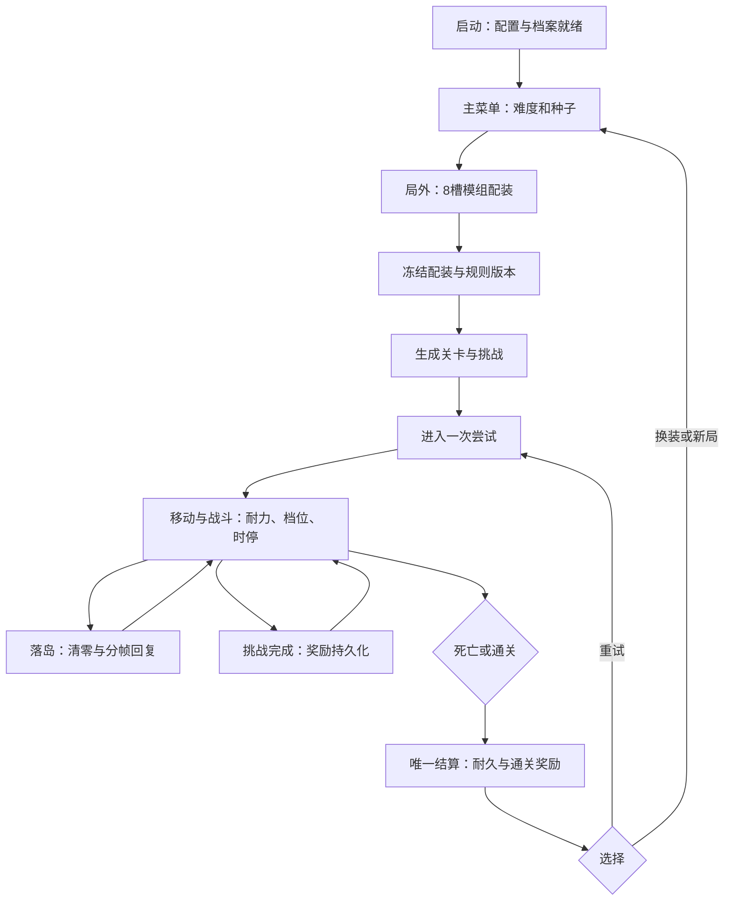

# SimpleACT 总体功能分析与开发流程

日期：2026-10-24。版本：分析稿 v0.1。读者：主策、程序、制作人。

本次交付是功能分析与实现方案，不代表功能已经实现或设计冲突已经获准修改。依据用户提供的《SimpleACT · 策划案 v1.0》Markdown（附录包含 v1.1 更名记录）、当前仓库代码及项目规则。原文见 [15-策划案来源快照](15-策划案来源快照.md)。所有原标记“待定”的数值仍为待定；本文中的新增技术设计均为建议。

## 1. 总体判断

这是 PC 单机横版跑酷 ACT。核心不是完整 RPG，而是“滞空升档 → 更便宜的动作与时停能力 → 精准操作续航 → 选择落岛清零保命”。局外装备、挑战、奖励与耐久服务这一循环。先做 90 秒最小切片，再做 EASY 完整闭环，最后扩展难度、种子竞速和正式视听表现。

现项目是 Unity 2022.3.62f2 + URP 14.0.12 / 2D Renderer + TEngine，具备资源、UI、事件、计时器、状态机、音频、对象池等基础设施。现有启动代码已接入对象池初始化，但尚未发现 SimpleACT 业务玩法。不能把“框架已有功能”当作“游戏系统已完成”。

## 2. 游戏功能流程

“一局、重试、挑战保留”在原文中混用，建议区分 Session（选图与挑战集合）、Attempt（一次生命）、Profile（永久档案）；见 01、08。该区分尚需策划确认。

## 3. 系统与文档地图

| 文档 | 功能与主要产出 |
|---|---|
| [01-规则冲突与范围决策](01-规则冲突与范围决策-v0.1.md) | 原文矛盾、缺项、推荐口径及影响；实现前优先阅读 |
| [02-框架映射与模块架构](02-框架映射与模块架构-v0.1.md) | 现有能力、7 个建议业务模块、生命周期、依赖与目录 |
| [03-输入与确定性模拟](03-输入与确定性模拟-v0.1.md) | 键鼠手柄、输入缓冲、固定 Tick、分时钟、随机流、种子与回放 |
| [04-角色动作耐力与速度档](04-角色动作耐力与速度档-v0.1.md) | 六类动作、动作锁、次数、消耗、升档和落地处理 |
| [05-战斗敌人与时停](05-战斗敌人与时停-v0.1.md) | 一击必杀、弹刀、闪避成功判定、敌人子弹、同帧裁决 |
| [06-关卡岛屿与难度生成](06-关卡岛屿与难度生成-v0.1.md) | 主路径、G1–G7、补给、难度、生成失败恢复 |
| [07-模组配装与效果](07-模组配装与效果-v0.1.md) | 模组实例、8 槽限制、效果叠加、永久基础模组 |
| [08-挑战奖励耐久与存档](08-挑战奖励耐久与存档-v0.1.md) | 挑战抽取、实时领奖、经济、一次性结算、本地持久化 |
| [09-界面镜头与设置](09-界面镜头与设置-v0.1.md) | 菜单、HUD、背包、结算、种子页、镜头与输入设置 |
| [10-美术音频与反馈](10-美术音频与反馈-v0.1.md) | 水彩几何、选择性褪色、分层音乐、特效与震动 |
| [11-配置资源与制作管线](11-配置资源与制作管线-v0.1.md) | 原 14 张表的落地、资源所有权、对象池、编辑器制作工具 |
| [12-分步实施与验收计划](12-分步实施与验收计划-v0.1.md) | 阶段目标、全部修改目标、伪代码、未来验收清单 |
| [13-GitHub参考方案调研](13-GitHub参考方案调研-v0.1.md) | 14 个独立项目，相关功能、借鉴方式、限制与采用意见 |
| [14-需求覆盖与交付记录](14-需求覆盖与交付记录-v0.1.md) | 原文章节追踪、文档完成项、尚未实施项 |

## 4. 模块划分摘要

建议新增 GameFlowModule（流程协调）、InputModule（设备与命令）、ConfigModule（只读配置快照）、RunModule（单局模拟）、LevelModule（关卡数据与装配）、ProfileModule（永久档案与交易）、FeedbackModule（视听表现）。

角色、耐力、速度档、战斗、时停、敌人、挑战是 RunModule 内部系统，先不要全部做成全局 Manager。镜头属于表现层；Luban 表是配置，装备模组是游戏物品，两者都不是 TEngine 框架 Module。

## 5. 开发顺序

| 阶段 | 交付 | 进入下一阶段条件 |
|---|---|---|
| S0 规则冻结 | 明确确定性目标、时停时钟、同帧裁决、死亡保留口径 | 01 中阻断项有确认结论 |
| S1 90 秒最小切片 | EASY 占位直道、动作、耐力、档位、岛、基础敌人、HUD、镜头 | 玩家愿意保持滞空，能理解落岛保命；测试需另行授权 |
| S2 EASY 完整竖切 | 配装、生成、挑战、掉落、耐久、存档、死亡通关闭环 | 全链路口径一致，重试不重复领奖扣耐久 |
| S3 难度与竞速 | 四难度、稳定种子、输入记录、版本化竞速成绩 | 明确版本边界内可重复，生成失败有兜底 |
| S4 正式表现与交付 | 水彩、音乐分层、手柄体验、正式配置资源 | 玩家体验与目标设备性能达标 |

无法根据策划案可靠承诺工期：运动/碰撞方案、模组实际数量、生成器覆盖、素材质量和团队产能尚未确定。最重的成本集中在确定性碰撞、可达性生成、战斗边界和存档结算，而非 UI 数量。

## 6. 本次执行边界

- [x] 完成策划与框架分析文档，保留原文待定项。
- [x] 给出至少 10 个对应功能的 GitHub 参考，实际收录 14 个。
- [ ] 确认冲突处理和第三方依赖选型。
- [ ] 功能代码、配置表、场景、Prefab 和资源制作。
- [ ] 编译、测试、Play Mode、性能或视觉验证。

后四项不是本次已完成成果。Markdown 文档按项目要求归档于 Docx；本次没有要求制作 Word 或实际 Excel 工作簿。
