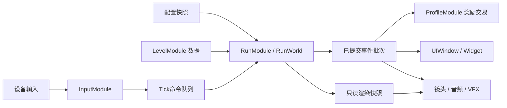

# SimpleACT 框架映射与模块架构

日期：2026-10-24；分析稿 v0.1；读者：程序。下列“已存在”为文件读取结果，“新增”为设计建议，不是已经存在的 API。

## 1. 当前项目事实

路径均相对 UnityProject，配置工程特例另标。分析期间对象池正在变化，本稿采用本次后续读取到的新框架实现，不引用已移除的旧 GameObjectPoolManager。

| 依据 | 已确认能力 | 本任务使用方式 |
|---|---|---|
| ProjectSettings/ProjectVersion.txt | Unity 2022.3.62f2 | 以该版本为兼容基线 |
| Packages/manifest.json | URP14、TMP、uGUI、HybridCLR；未列 Input System/Cinemachine | Input System 是候选新增依赖，不能说已安装 |
| ProjectSettings/GraphicsSettings.asset → Assets/Settings/UniversalRP.asset → Renderer2D.asset | 全局渲染资源指向 URP 2D Renderer | 视听方案针对 URP14，非 Unity6 RenderGraph |
| ProjectSettings/ProjectSettings.asset | activeInputHandler=0 | 当前旧输入系统；切新输入涉及设置与 UI EventSystem |
| ProjectSettings/EditorBuildSettings.asset | 启用 SampleScene | 不把它当成已完成的 SimpleACT 游戏关卡 |
| Assets/GameScripts/HotFix/GameLogic/GameApp.cs | Entrance 先 GameEventHelper.Init；StartGameLogic 初始化并预热对象池；退出释放池、单例与门面 | 扩展启动就绪流程，不能覆盖现有池初始化 |
| 同目录 GameModule.cs | Resource/UI/Scene/Audio/Timer/Fsm/Procedure 等门面，现含 GameObjectPool | 复用基础设施；新增业务门面只在实现获批后加入 |
| Assets/TEngine/Runtime/Module/UpdataDriver/IUpdateDriver.cs | Update/FixedUpdate/LateUpdate 订阅与移除 | RunModule 只注册一个驱动点 |
| Assets/TEngine/Runtime/Module/FsmModule/FsmModule.cs | IUpdateModule 的逐帧 FSM 驱动 | 适用于菜单流程；不把它当 60Hz 战斗状态机 |
| Assets/TEngine/Runtime/Module/GameObjectPoolModule/ | 预制体直引用、注册、预热、TrySpawn、Despawn、业务回调与租约版本 | 复用子弹/敌人/效果 View，不新增另一套池 |
| Assets/GameScripts/HotFix/GameLogic/Module/UIModule/ | UIWindow、UIWidget、ShowUIAsyncAwait、AddUIEvent | 新增业务 UI 类，保留现有框架 |
| 仓库 Configs/GameConfig/ | Luban 表索引、生成脚本、ConfigSystem 模板 | 已有生成链路，但 GameProto 下未发现 Tables/ConfigSystem 成品 |

依赖存在不等于已通过编译、Prefab 绑定或运行验证。本次只做静态分析。

## 2. 建议的业务模块与内部系统

| 新模块 | 责任/生命周期 | 拥有的系统 | 不负责 |
|---|---|---|---|
| ConfigModule | App；加载并提供只读规则版本 | ConfigLoader、RuleSnapshotBuilder | 业务耐力值、局内随机 |
| InputModule | App；设备输入转命令、设备切换 | InputRouter、BindingStore | 直接移动角色或扣耐力 |
| GameFlowModule | App；启动、菜单、加载、游玩、结算、退出 | FlowStateMachine、启动/退出协调 | 战斗逐帧细节 |
| RunModule | Attempt；拥有权威 RunWorld | Action、Motor、Stamina、SpeedTier、Combat、TimeStop、Enemy、Projectile、Challenge、Progress 系统 | 文件 IO、直接操纵 UI |
| LevelModule | Session 数据 + Attempt View 装配 | LevelGenerator、Reachability、LevelAssembler | 玩家耐力决策、持久化奖励 |
| ProfileModule | App；永久库存、设置、种子、解锁、交易 | Loadout、Reward、Durability、Save 系统 | 碰撞、动画 |
| FeedbackModule | App 服务、Attempt 绑定 | FeedbackRouter、DynamicMusic、Vfx、Haptics | 授予奖励、改变模拟结果 |

7 个模块是责任边界，不是必须 7 个独立程序集，也不是每个内部系统都需要接口/单例。首版全部业务保持 GameLogic；只在可替换边界（输入源、存档介质、确定性碰撞实现）设置小接口。继承只用于已有 UIWindow/UIWidget、必要的模块基类或 Singleton 约定，战斗行为优先组合。

## 3. 目录建议

```text
Assets/GameScripts/HotFix/GameLogic/
  GameApp.cs                        扩展既有入口
  GameModule.cs                     业务服务入口（新增属性是未来目标）
  Module/
    GameFlowModule/  InputModule/  ConfigModule/
    RunModule/     LevelModule/    ProfileModule/  FeedbackModule/
  Core/
    Simulation/   Character/  Combat/  Enemy/  Level/  Challenge/
    Equipment/    Replay/    Data/     View/
  IEvent/                           已生成事件机制的接口定义
  UI/                               新增窗口/Widget；绑定由项目生成器产生
Assets/GameScripts/HotFix/GameEditor/  配置检查与关卡制作工具
Assets/GameScripts/HotFix/GameProto/   Luban 生成数据类型
Assets/AssetRaw/                     关卡/角色/UI/音效等业务资源
```

Manager、模块生命周期与服务数据归 Module；Core 中的系统是被 RunWorld 等显式持有的具体领域行为。该布局是本项目建议，不从其他项目直接套用。

## 4. 数据流与依赖



初始化时 GameFlow 可经 GameModule 获取服务并装配依赖；运行中跨模块结果通知走 GameEvent。确定性核内部由固定顺序同步调用系统，不能靠全局监听器注册顺序决定伤害与奖励。事件在 Tick 提交后桥接至 TEngine；UI 使用 RegisterEvent 中的 AddUIEvent。输入/配装操作作为命令请求，成功结果再广播。

避免两个真相来源：Stamina 只由模拟写；持久库存只由 Profile 写；装备局内效果只读开局快照；镜头不能决定敌人是否开火。事件负载应含 AttemptId、TickId、EventId，使用值数据或不可变快照，禁止把即将回池的对象作为延迟事件内容。

## 5. 生命周期与异步边界

建议初始化顺序：事件系统 → 配置和档案加载 → 对象池设置/预热就绪 → 输入/反馈服务 → 主菜单 → 冻结规则和配装 → Level 数据生成 → 场景与 View 就绪 → RunWorld 开始 Tick。

当前对象池预热为后台 Forget；未来开局需要可等待的“必要资源就绪”屏障，不能因为 StartGameLogic 已返回就开始生成必需 View。

建议销毁顺序：禁入新命令 → 停 Tick → 固化未提交结果 → 取消 Attempt 任务 → 解绑事件与视图 → 回收本局实例 → 卸载本局资源 → 清除 Session（若退出新局）→ 应用退出时再关闭 App 模块。

所有异步结果检查所属 generation/AttemptId；取消只是请求，不保证已经返回的结果会自动释放。取消后拿到资源的代码仍需归还。Unity 对象 API 在主线程调用；纯配置解码/文件字节 IO 才可独立后台处理。

## 6. 与规范存在的张力

Luban 模板是同步 LoadAsset 加懒加载，而项目要求 IO 异步优先；方案为 ConfigModule 先异步预载字节，再给 Tables 提供内存 ByteBuf。不是直接让 GameProto 反向引用 GameModule。新对象池按已加载 Prefab 同步 Instantiate，这是现有池内部职责；业务不得绕开池再创建散落的 Instantiate 路径。

TEngine 的 Update FSM 不等于固定 Tick 战斗 FSM；菜单继续复用，玩家动作使用显式 Tick 推进。上述为设计边界说明，不在本次修改框架。

## 7. 后续修改目标（未执行）

- [ ] 扩展 GameApp 和 GameModule：接入业务生命周期及只读门面，保留对象池启动关闭逻辑。
- [ ] 添加 7 个模块的最小骨架：按实际阶段建立，避免一次生成空壳。
- [ ] 添加 RunWorld、输入命令、事件批次和 Profile 数据边界。
- [ ] 接入配置预载、场景/View 装配与退出取消链。

验收计划：重复进入/退出关卡不增加监听器、旧 Attempt 异步回调不污染新局、UI 开关不改变同输入模拟结果。未运行。
