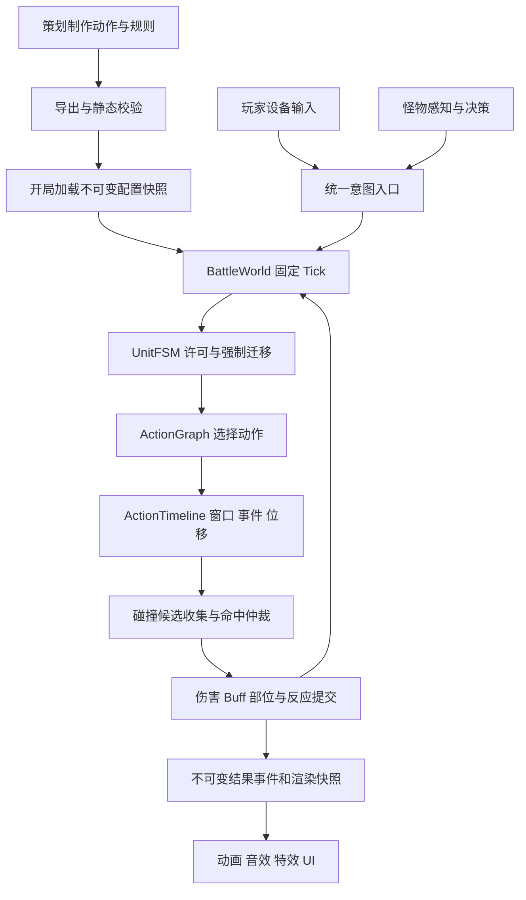

# 战斗系统框架：总功能分析与阅读导航

日期：2026-10-25。版本：v0.1 设计提案。范围：解释并完善「游亚的框架设计」，给出 Parkour / TEngine 中的实施方案。**本文档集不是已实现系统；没有修改业务代码、安装依赖或运行验证。**

## 1. 这个框架究竟做什么

它要把 ACT 战斗中反复出现的“输入、选择动作、执行动作、命中、受击、反馈”变为一套共享机制，让策划通过动作时间轴和动作图制作招式，让玩家输入和怪物 AI 使用相同的规则执行招式。

原文的长处在于动作制作和执行链；它还不是完整战斗规格。数值归属、伤害提交顺序、取消后的资源清理、Buff 叠层、部位破坏、回放范围等仍需补全。本文档集保留核心思想，补全这些契约，并指出不宜直接采用的设计。

一句话方案：**TEngine 提供基础设施，BattleWorld 统一推进战斗；UnitFSM 决定能做什么，ActionGraph 决定接哪招，ActionTimeline 决定这一招何时生效，HitResolver 决定打中了谁，CombatRuleSet 决定结果，View 负责显示结果。**

## 2. 总流程

配套静态图见 [框架总图](images/01-框架总图.svg)。

## 3. 功能拆分与阅读顺序

| 文档 | 回答的问题 |
|---|---|
| [01 原文解析与问题](01-原文逐章解析与问题清单.md) | 原文到底说什么，哪些地方存在冲突、遗漏或不成立的承诺 |
| [02 框架与数据契约](02-整体架构与核心数据契约.md) | 谁拥有数据、谁有修改权、模块如何协作 |
| [03 时钟与执行顺序](03-固定帧时钟与战斗执行顺序.md) | 60Hz、卡顿、时停和同帧裁决怎么做 |
| [04 输入与语境](04-输入语境与意图缓冲.md) | 玩家与 AI 如何统一输入，缓冲怎样消费 |
| [05 UnitFSM](05-单位状态与打断仲裁.md) | 禁攻、眩晕、死亡、霸体如何影响动作 |
| [06 动作图](06-动作图与连招执行器.md) | 连招、取消、自动派生、并行和环怎么执行 |
| [07 编辑器与 UAnim](07-复合动作编辑器与数据管线.md) | 策划怎么制作内容、配置如何导出和热更 |
| [08 动画与移动](08-动画后端与移动协作.md) | Sprite、Playables、Spine 怎么共存，位移谁来控制 |
| [09 命中系统](09-碰撞命中与去重.md) | 多部位、多段、穿透、互击如何裁决 |
| [10 战斗结果](10-伤害属性Buff与部位破坏.md) | 补齐数值、Buff、削韧、死亡与部位规则 |
| [11 AI](11-AI决策与行为树.md) | 状态表、行为树、动作图分别负责什么 |
| [12 事件与表现](12-事件结果流与表现生命周期.md) | 怎样低分配地通知表现，取消和回池怎么清理 |
| [13 项目接入](13-Parkour项目接入方案.md) | 当前项目实际有什么，要改哪些文件、如何初始化 |
| [14 设计原则](14-七大原则与设计模式取舍.md) | 七大原则和模式如何具体落在本框架中 |
| [15 GitHub 调研](15-GitHub十四项目调研与选型.md) | 14 个仓库分别借鉴什么，为什么不能照搬 |
| [16 程序策划案](16-面向程序的战斗系统策划案.md) | 程序能按什么规则、数据和用例实现 |
| [17 图文案例](17-战斗系统图文应用案例.md) | 用实际时间线解释框架如何运行 |
| [18 分步落地](18-分步落地目标与验收计划.md) | 从第一批脚本到内容工具，每步改什么、怎么交付 |
| [19 来源与交付](19-来源覆盖与交付记录.md) | 原文覆盖、事实依据、完成与未完成边界 |

快速阅读：00 → 01 → 02 → 13 → 18。程序实现前：03–12 → 16。理解运行效果：17。

**逐步实施入口**：[分步实施总索引](分步实施/00-执行总索引.md)。新增 43 篇独立步骤方案（另含 1 篇总索引），将 S0–S7 细化为每步的目标、需求、依赖、修改文件、具体任务、伪代码、完成标准和实施记录。01–37 为基础框架及制作工具，38–43 按需选择；所有实现项仍为未完成。

## 4. 推荐实施范围与假设

**建议首版**：单机、2D、SpriteSequence、60Hz 战斗逻辑，一名玩家、一种近战敌人、一种弹丸；实现两段攻击、闪避、受击、死亡、一个 Buff 和一个可破坏部位。此范围用于证明架构闭环，并非用户已经确认的玩法或平台。

保持 3D / Spine 的适配接口，但不同时实现三套后端。首版不承诺跨平台确定性、联网回滚、大型 Boss 全机制、任意并行行为或全功能时间轴。若项目最终要求确定性跑酷回放，碰撞和运动必须先确定为受控模拟，不能把 Unity 物理版本直接宣称满足该要求。

现有 SimpleACT 文档是另一个玩法方案背景，不能覆盖本次 Notion 的框架需求。通用战斗规则与 SimpleACT 的一击必杀、精准闪避和时停通过规则集适配，不能硬编码成所有 ACT 的公共规则。

## 5. 文档交付的判断标准

- 每个系统说明内容、用途、边界、数据、执行流程、异常分支及实现位置。
- 原文陈述、项目代码事实、本文建议分别标识；未定规则有推荐值和影响说明。
- GitHub 至少 10 个独立仓库，写明实际阅读范围、适配成本与取舍。
- 至少三个端到端示例能追踪输入、状态、动作、命中和反馈。
- 实施目标带路径和伪代码；未来验证项全部标为未执行。

原始入口：[游亚的框架设计](https://app.notion.com/p/40057765a5d081caba2ada3092ccf76a)。后续编码仍须确认实施批次。
