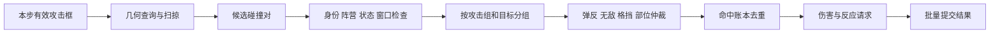

# 碰撞、命中与去重

日期：2026-10-25；v0.1。对应原文04，并补全跨帧、多部位、多段和弹丸规则。

## 1. 从接触到结果

Hitbox 是伤害来源区域，Hurtbox 是可受击区域，ParryRegion 是可弹反区域，身体移动碰撞框是阻挡几何；四者不能用同一个Collider替代所有语义。

## 2. 首版碰撞实现选择

推荐2D战斗Hitbox使用逻辑矩形/圆形数据直接查询；静态场景阻挡可经 ICombatQuery/MotorQuery 适配 Unity Physics2D。首版不依靠OnTrigger回调直接伤害。几何测试必须读取同一Tick的前后姿态。

高速弹丸和位移攻击用扫掠；仅检查终点重叠会穿过薄目标。首版如暂时只支持轴对齐矩形，必须在schema中限制旋转框，不能假装任意OBB已支持。旋转长武器扩展可采用分段扫掠或保守包络再窄相测试。

项目最终若要求跨平台确定性，应在第一阶段选固定数值与受控几何；浮点Physics2D适配版仅作为普通单机版本，不能后加一个“固定Tick”标志就变成确定性版。

## 3. 去重键与重击策略

默认一次伤害去重键：`(battleId, attackerId, actionInstanceId, hitGroupId, targetEntityHandle)`。

| 策略 | 行为 |
|---|---|
| OncePerAttackGroup | 该攻击组整个生命周期对目标一次，不是每帧一次 |
| MultiPulse | 不同pulseId允许再次伤害，如三段旋风 |
| Interval | 同目标下一次允许UnitTick/SimTick达到阈值后结算，时间域显式指定 |
| PerPart | 只有设计明确要求才以partId加入去重键 |

被无敌拦截的接触默认不占“成功伤害”次数，但保留本帧处理标记防重复事件；格挡/弹反默认消费该攻击对目标的机会。攻击框持续期间无敌结束后可受击，这是此默认规则的结果，需在玩法策划中明确。

一把剑有多个Hitbox可以共用hitGroup，避免双倍伤害。第二次播放同一个ActionDefinition必须生成新实例ID，否则目标永远不能被第二刀命中。

## 4. 同目标多部位

先收齐同攻击组对同目标的所有候选，再选择有效部位。推荐默认 `partPriority降序 → contactTime升序 → partId升序`；不要按物理回调先后选，也不要默认挑伤害最高以免总打弱点。

选择一个部位后计算一份HP伤害和对应部位伤害；不要分别对每个框扣HP再尝试回滚。部位破坏但仍可受击时，根据PartDefinition改变倍率/形状，不默认移除整单位Hurtbox。

## 5. 弹反、格挡与无敌

推荐命中分类：目标已无效/阵营过滤 → 无敌（除穿透无敌标签）→ 合法弹反区域与窗口 → 朝向/资源满足的格挡 → 普通命中。某招是否能弹、是否无视格挡由DamageDefinition标签声明。

弹反与伤害必须来自同一候选裁决，不能另一个监听器先扣HP再把血加回来。弹反成功发反击/削韧请求；是否自动反击由规则集决定。格挡耐力不足转GuardBreak，并明确是否有溢出HP伤害。

## 6. 弹丸身份与寿命

ProjectileRuntime 有独立entityHandle、来源AttackId、阵营、速度、剩余寿命、穿透次数和命中账本。发射后默认不依赖发射者仍存活；发射者死亡不应让空中所有弹丸自然丢失来源数据。反射弹创建新的攻击归属/代次，旧命中账本按反射规则清理，防立刻重复命中同一点。

取消只作废尚未执行的发射命令；已生成弹丸的取消策略 `Independent / CancelWithOwnerAction` 写进定义。

## 7. 容量和错误

候选、结果和账本预分配；达到容量不能静默丢命中。演示版建议抛出结构化 BattleFault 并停止本场，保持诊断；正式版可在非Tick边界预扩容/分页。内容上限由压测后设定，不能随意给“几千个”并声称安全。

拟新增 `Core/Battle/Hit/` 的 HitCollector、HitResolver、HitLedger；ProjectileSystem另放Projectile目录。未来用例：同帧两部位只一次；连续6帧重叠只一次；三段三次；子弹扫掠；阵营过滤；同时互击；候选溢出可见。本次未执行。
