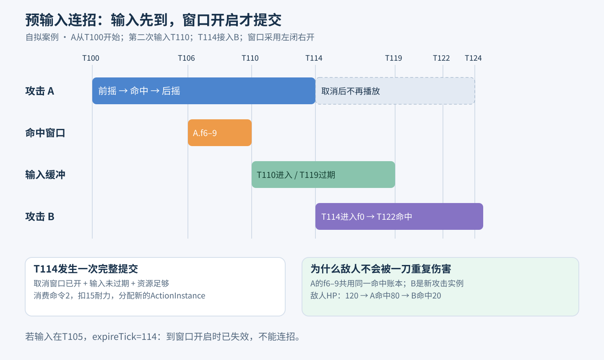
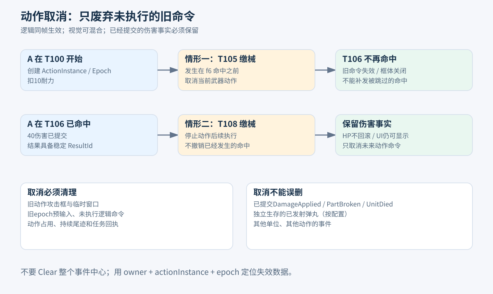
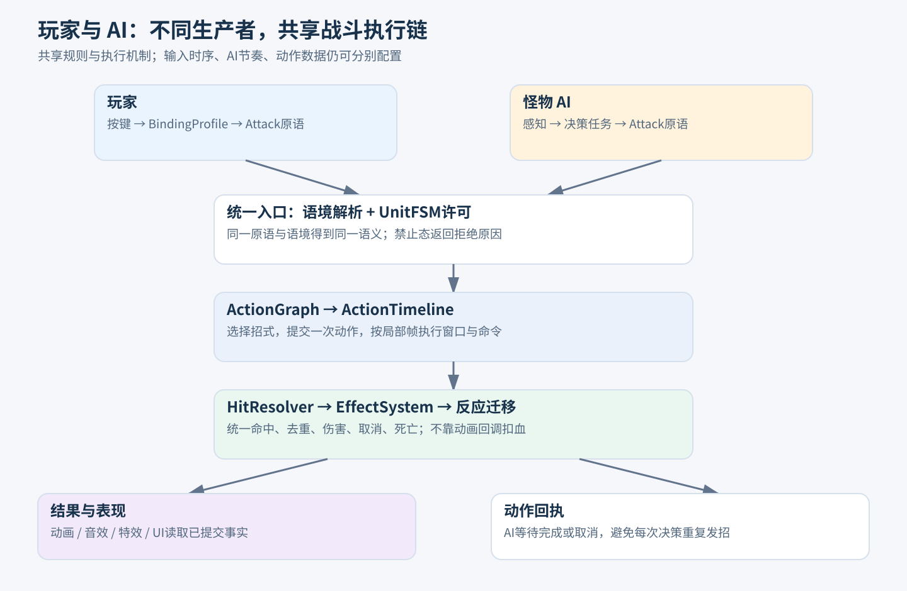

# 战斗系统图文应用案例

日期：2026-10-25；v0.1。以下全部是根据推荐规则推演的教学案例，**不是运行截图或已通过的测试**。图为本次制作的框架示意图；数值为16文档中的自拟演示数据。

## 案例一：提前按键为什么能接上第二刀

玩家在T100开始攻击A，T110再次按下攻击。A的取消窗口是局部帧 `[14,20)`；第二次输入可保留至T119之前，因此T114窗口开启时接上B。

| Tick | 输入/状态 | 框架执行 | 可见效果 |
|---:|---|---|---|
| 100 | Attack命令1 | FSM许可→动作图选择A→扣10耐力→A.f0 | 播攻击前摇 |
| 106 | A.f6有效 | 开攻击框→命中敌人→扣40HP | 剑光/命中特效，Enemy120→80 |
| 107–109 | 仍重叠 | HitLedger发现已命中，不重复扣血 | 可持续显示剑光，无重复伤害 |
| 110 | Attack命令2 | 取消窗口未开，缓冲到119 | A继续后摇 |
| 114 | A.f14 | 合法转移→消费命令2→扣15→新B实例f0 | 接第二刀 |
| 122 | B.f8 | 新AttackId，允许再命中→60伤害 | Enemy80→20 |

涉及组件：IntentBuffer、PermissionEvaluator、ActionGraphRunner、ActionTimeline、HitLedger、DamageCalculator、PresentationBridge。

反例：若第二次输入在T105，则expireTick=114，T114已经过期，不能接招。若把9帧缓冲误写成 `tick <= expireTick`，边界会多一帧。若把取消帧数藏在Sprite播放器里，程序难以解释为何动作图没有选边却突然跳招。

## 案例二：攻击中被缴械，哪些东西该清，哪些不能清

玩家T100开始攻击A，在T105收到“缴械且取消当前武器动作”的已提交效果。UnitFSM/权限系统立即禁武器攻击，CancelAction关闭该实例；T106原定命中不再发生。

| 数据 | 处理 | 原因 |
|---|---|---|
| 旧动作未执行的f6命中命令 | 作废 | 来源ActionEpoch已变 |
| 旧动作攻击框/霸体/无敌窗口 | 关闭/解除来源 | 不能让旧能力遗留 |
| 旧预输入 | 失效 | 防止缴械后突然接第二刀 |
| 已扣除10耐力 | 保留 | 演示默认取消不退款 |
| 旧姿态 | 可作为视觉混合输入 | 只是画面，不继续伤害 |
| 当前Move请求 | 按缴械许可继续 | 不因视觉滑出12帧而额外禁移动 |

另一种时序：若T106已经提交40伤害，T108才被缴械，40伤害必须保留。不能在清空未flush事件时把伤害结果抹掉，也不能撤销已经播出的命中事实。

程序落点：ActionCancelService按ActionHandle清理逻辑命令；CombatResultBuffer不回滚；状态结果只提交一次最终目标姿态。AI若在等待这次动作，收到Cancelled回执后重新决策。

## 案例三：同一套招式由玩家和AI执行

玩家按J，经绑定层得到Attack原语；敌人评分/行为树判断近距离可以出招，同样提交Attack原语。二者都经过Resolver、许可、动作图与时间轴。区别在各自配置，不在两份Attack函数。

示例Boss按目标位置派生：正前方选择扇形攻击，侧方选择侧扫。AI只发布Attack与请求参数；ContextSnapshot提供目标方向，动作图条件边选择对应ActionDefinition。链内auto边负责后续追击，AI不每6Tick重复发攻击。

| 步骤 | 玩家 | AI |
|---|---|---|
| 请求来源 | 按键边沿 | BehaviourRunner选中AttackTask |
| 请求身份 | commandId=玩家输入序号 | commandId=AI任务提交序号 |
| 权限失败 | 返回资源不足/状态禁止 | 同一拒绝码，AI可回退到移动 |
| 执行中 | 等待新的玩家输入 | 持有ActionHandle，保持Running |
| 被打断 | 动作取消，旧输入失效 | 动作取消，旧等待结束，重新感知 |

共享的是执行机制。玩家9帧预输入、敌人6Tick决策间隔、不同取消窗口都可分别配置；修改玩家动作资产不会无意覆盖所有敌人。

## 案例四：霸体、削韧与部位破坏是三件事

敌人护甲部位：HP倍率0.5，耐久50；攻击B基础60伤害，故对护甲造成30HP伤害和30部位伤害。敌人临时霸体免普通硬直，但仍损HP和Poise。

1. 第一次B命中：Enemy HP120→90；部位耐久50→20；Poise40→15；霸体阻止普通硬直。
2. 下一次B命中：HP90→60；部位耐久20→0并Broken；Poise15→0触发破韧请求。
3. 提交一次PartBroken和一份高优先级破韧反应；不会因为部位破坏再扣一遍HP。
4. 后续该部位倍率改1.0；下一次B按60伤害计算。当前破坏击保持30，不中途换倍率重算。

如果死亡与破部位同Tick发生，两件事实都记录，表现最终选死亡；掉落系统按ResultId/结算事务去重。用这个例子可以发现“给部位加一个耐久字段”不足以完成整套功能。

## 案例五：闪避、局部时停和Buff的时间为什么不能共用一个计数器

玩家T200进入Dodge；局部无敌 `[2,8)` 即T202–207。敌方在T205命中时无效，T208再次有效接触则可以造成伤害。

在扩展的SimpleACT规则中，T205若满足精准闪避与档位条件，创建时停请求：假设演示冻结敌人12个SimTick，从下一Tick T206起至T218之前冻结。T206–217敌人UnitTick、ActionFrame、弹丸运动停止，玩家继续。T218解冻。**12Tick是此例自拟值，正式时停时间应读对应玩法配置。**

| 时钟/对象 | 冻结期间 |
|---|---|
| SimTick和时停结束Tick | 继续，否则无法结束时停 |
| 敌人OwnerUnit域Buff | 冻结 |
| SimTick域世界危险效果 | 继续，除非规则另禁 |
| 玩家ActionFrame | 正常推进 |
| UI动画 | 可继续，不决定解冻 |

同一次Dodge遇三颗子弹，精准奖励按DodgeActionId只发一次。时停期间是否允许再次奖励由SimpleACT规则控制，推荐拒绝续时和重复支付；这些是玩法策略，不写死在基础时钟中。

## 案例六：对象池复用为何需要逻辑代次

T300敌人E7死亡，View实例V被归还；T301新敌人E8借到同一个V。T302旧命中特效异步加载完成。

若回调只判断V不为null，就会把E7的特效挂到E8。正确做法比较 `BattleId + EntityId + Generation + ViewBindingGeneration`；不匹配则归还资源。需要显示旧死亡位置的残留效果，应使用结果中保存的位置，生成独立短生命周期表现。

该问题不靠“Unity主线程”自动解决：异步完成发生在不同生命周期，即使都在主线程也可能写错对象。

## 如何用案例推动实现

先完成案例一验证普通链路，再完成案例二验证取消和权威边界；案例三验证共用机制；案例四补数值与部位；案例五只在需要SimpleACT规则时扩展；案例六是所有异步View都应具备的生命周期约束。这里只做规则推演，未来检查请求获准后才执行。
