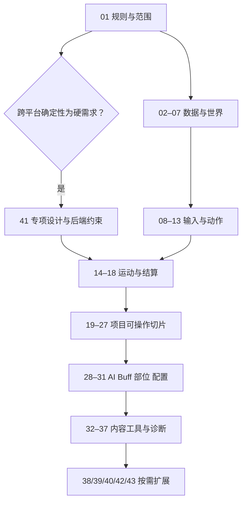

# 战斗系统框架：分步实施总索引

版本：v0.1｜日期：2026-10-25｜本次交付：43 篇独立步骤文档 + 本索引，共 44 篇新增 Markdown。**文档已编写，代码、资源制作与运行检查均未开始。**

## 1. 这套文档怎么用

上层设计解释“为什么这样设计”，本目录解释“下一步具体怎么实施”。从 [总体架构](../02-整体架构与核心数据契约.md) 和 [程序策划案](../16-面向程序的战斗系统策划案.md) 获取统一规则，再按本索引推进。原 [18 分步落地总计划](../18-分步落地目标与验收计划.md) 保留 S0–S7 总览；本目录将其细化为可逐步交接的任务。

每篇均包含：目标与需求编号、前置依赖、输入输出、全部拟修改文件、逐项“做什么/为什么/怎么做”、任务伪代码、整步伪代码、失败边界、完成标准以及实施记录。每个实现复选框初始均未勾选。实施某一步时先确认该批次，再按真实完成情况记录，不把写完文档当成功能完成。

阅读顺序默认按编号。依赖栏是必须满足的能力，并非精确工期或自动调度脚本；没有依赖不表示已授权并行修改。如当前批次只有契约而依赖实现尚未完成，可以定义接口或使用明确的开发替身，但不能把该步标为集成完成。

## 2. 路径前缀与修改边界

以下路径相对 Unity 项目根目录 `UnityProject/`。前缀只用于缩短表格，不是建议真的创建名为 G/E/P 的文件夹。

| 前缀 | 实际路径 |
|---|---|
| G | `Assets/GameScripts/HotFix/GameLogic/` |
| E | `Assets/GameScripts/HotFix/GameEditor/` |
| P | `Assets/GameScripts/HotFix/GameProto/` |
| A | `Assets/` |
| D | `Docx/架构设计/战斗系统框架/` |

现有文件如 GameApp.cs、GameModule.cs 在步骤内标为“修改”；其他新类型均为提案。未定位的 Luban 源工程、实际资源收集配置会明确写出实施前定位要求，不编造已存在的目录。Scene、Prefab、asmdef 等序列化资源按项目要求通过 Unity CLI/编辑器处理；不手改生成文件和 .meta。

本次沿用同会话已读取的 tengine-dev 规范、项目源码事实及 [14 仓库调研](../15-GitHub十四项目调研与选型.md)。这是既有设计的细化，没有重新安装或运行调研项目。

## 3. 阶段与可交付里程碑

| 里程碑 | 步骤 | 对应旧阶段 | 达到什么状态 |
|---|---|---|---|
| M0 冻结基线 | 01 | S0 | 平台、后端、规则、确定性和首批范围明确 |
| M1 可推进逻辑骨架 | 02–07 | S1 | 身份、数据、加载、时钟、阶段与单位可协作 |
| M2 可执行动作链 | 08–13 | S2 | 资源事务、输入、状态、动作和连招形成闭环 |
| M3 逻辑战斗闭环 | 14–18 | S3 | 运动、命中、伤害、反应与弹丸统一执行 |
| M4 可操作基础切片 | 19–27 | S4 | 模块、表现、资源、场景、HUD及退出接通 |
| M5 完整机制演示 | 28–31 | S5 | AI、Buff、部位破坏和正式配置接入 |
| M6 内容制作与诊断 | 32–37 | S6 | 编辑、导出、校验、发布和诊断闭环 |
| 可选扩展 | 38–43 | S7 | 按实际玩法需求分别选择，不属于首版必做项 |

步骤 41 是确定性/联网的**专项设计入口**。若跨平台确定性是首版硬要求，必须在步骤 01 后立即进行，先于步骤 14 的运动/碰撞后端实现；编号 41 不代表一定最后做。步骤 39 每批选择一种实际需要的动画后端。步骤 40、42、43 分别处理多通道、倍率、复杂 AI，避免一个步骤覆盖三种独立能力。

## 4. 全部步骤与依赖

| 步骤 | 独立文档 | 阶段 | 前置步骤 | 实施状态 |
|---|---|---|---|---|
| 01 | [冻结实施范围与战斗规则](01-冻结实施范围与战斗规则.md) | S0 | 入口 | 未实施 |
| 02 | [建立逻辑身份与基础契约](02-建立逻辑身份与基础契约.md) | S1 | [01](01-冻结实施范围与战斗规则.md) | 未实施 |
| 03 | [定义不可变战斗数据与演示样例](03-定义不可变战斗数据与演示样例.md) | S1 | [02](02-建立逻辑身份与基础契约.md) | 未实施 |
| 04 | [加载版本清单并冻结配置快照](04-加载版本清单并冻结配置快照.md) | S1 | [03](03-定义不可变战斗数据与演示样例.md) | 未实施 |
| 05 | [实现固定步调度与多时间域](05-实现固定步调度与多时间域.md) | S1 | [02](02-建立逻辑身份与基础契约.md) | 未实施 |
| 06 | [建立世界阶段与命令结果缓冲](06-建立世界阶段与命令结果缓冲.md) | S1 | [02](02-建立逻辑身份与基础契约.md)、[05](05-实现固定步调度与多时间域.md) | 未实施 |
| 07 | [建立单位运行数据与注册销毁](07-建立单位运行数据与注册销毁.md) | S1 | [03](03-定义不可变战斗数据与演示样例.md)、[06](06-建立世界阶段与命令结果缓冲.md) | 未实施 |
| 08 | [实现基础属性与资源事务](08-实现基础属性与资源事务.md) | S2 前置 | [07](07-建立单位运行数据与注册销毁.md) | 未实施 |
| 09 | [实现意图解析与预输入缓冲](09-实现意图解析与预输入缓冲.md) | S2 | [06](06-建立世界阶段与命令结果缓冲.md)、[07](07-建立单位运行数据与注册销毁.md) | 未实施 |
| 10 | [实现单位状态与权限矩阵](10-实现单位状态与权限矩阵.md) | S2 | [07](07-建立单位运行数据与注册销毁.md)、[09](09-实现意图解析与预输入缓冲.md) | 未实施 |
| 11 | [实现动作起手事务与统一取消](11-实现动作起手事务与统一取消.md) | S2 | [08](08-实现基础属性与资源事务.md)、[09](09-实现意图解析与预输入缓冲.md)、[10](10-实现单位状态与权限矩阵.md) | 未实施 |
| 12 | [实现动作时间轴与窗口求值](12-实现动作时间轴与窗口求值.md) | S2 | [03](03-定义不可变战斗数据与演示样例.md)、[06](06-建立世界阶段与命令结果缓冲.md)、[11](11-实现动作起手事务与统一取消.md) | 未实施 |
| 13 | [实现动作图与连招派生](13-实现动作图与连招派生.md) | S2 | [09](09-实现意图解析与预输入缓冲.md)、[11](11-实现动作起手事务与统一取消.md)、[12](12-实现动作时间轴与窗口求值.md) | 未实施 |
| 14 | [实现唯一位移写者与几何查询适配](14-实现唯一位移写者与几何查询适配.md) | S3 | [01](01-冻结实施范围与战斗规则.md)、[07](07-建立单位运行数据与注册销毁.md)、[12](12-实现动作时间轴与窗口求值.md) | 未实施 |
| 15 | [实现命中收集与跨帧去重账本](15-实现命中收集与跨帧去重账本.md) | S3 | [12](12-实现动作时间轴与窗口求值.md)、[14](14-实现唯一位移写者与几何查询适配.md) | 未实施 |
| 16 | [实现伤害计算与批次效果提交](16-实现伤害计算与批次效果提交.md) | S3 | [08](08-实现基础属性与资源事务.md)、[15](15-实现命中收集与跨帧去重账本.md) | 未实施 |
| 17 | [实现受击反应与死亡收尾](17-实现受击反应与死亡收尾.md) | S3 | [10](10-实现单位状态与权限矩阵.md)、[11](11-实现动作起手事务与统一取消.md)、[16](16-实现伤害计算与批次效果提交.md) | 未实施 |
| 18 | [实现弹丸独立生命周期与扫掠命中](18-实现弹丸独立生命周期与扫掠命中.md) | S3 | [14](14-实现唯一位移写者与几何查询适配.md)、[15](15-实现命中收集与跨帧去重账本.md)、[16](16-实现伤害计算与批次效果提交.md) | 未实施 |
| 19 | [接入战斗模块与唯一更新驱动](19-接入战斗模块与唯一更新驱动.md) | S4 | [04](04-加载版本清单并冻结配置快照.md)、[06](06-建立世界阶段与命令结果缓冲.md)、[13](13-实现动作图与连招派生.md)、[17](17-实现受击反应与死亡收尾.md)、[18](18-实现弹丸独立生命周期与扫掠命中.md) | 未实施 |
| 20 | [接入设备输入与焦点暂停处理](20-接入设备输入与焦点暂停处理.md) | S4 | [09](09-实现意图解析与预输入缓冲.md)、[19](19-接入战斗模块与唯一更新驱动.md) | 未实施 |
| 21 | [实现Sprite表现与单位视图绑定](21-实现Sprite表现与单位视图绑定.md) | S4 | [12](12-实现动作时间轴与窗口求值.md)、[14](14-实现唯一位移写者与几何查询适配.md)、[19](19-接入战斗模块与唯一更新驱动.md) | 未实施 |
| 22 | [建立资源租约与对象池接入](22-建立资源租约与对象池接入.md) | S4 | [04](04-加载版本清单并冻结配置快照.md)、[19](19-接入战斗模块与唯一更新驱动.md)、[21](21-实现Sprite表现与单位视图绑定.md) | 未实施 |
| 23 | [接入启动就绪链与演示入口](23-接入启动就绪链与演示入口.md) | S4 | [19](19-接入战斗模块与唯一更新驱动.md)、[20](20-接入设备输入与焦点暂停处理.md)、[21](21-实现Sprite表现与单位视图绑定.md)、[22](22-建立资源租约与对象池接入.md) | 未实施 |
| 24 | [桥接战斗结果到音效特效与外部事件](24-桥接战斗结果到音效特效与外部事件.md) | S4 | [06](06-建立世界阶段与命令结果缓冲.md)、[21](21-实现Sprite表现与单位视图绑定.md)、[22](22-建立资源租约与对象池接入.md)、[23](23-接入启动就绪链与演示入口.md) | 未实施 |
| 25 | [制作战斗调试HUD与只读诊断](25-制作战斗调试HUD与只读诊断.md) | S4 | [24](24-桥接战斗结果到音效特效与外部事件.md) | 未实施 |
| 26 | [制作演示场景与单位资源接线](26-制作演示场景与单位资源接线.md) | S4 | [23](23-接入启动就绪链与演示入口.md)、[24](24-桥接战斗结果到音效特效与外部事件.md)、[25](25-制作战斗调试HUD与只读诊断.md) | 未实施 |
| 27 | [完成退出回收与重进生命周期](27-完成退出回收与重进生命周期.md) | S4 | [19](19-接入战斗模块与唯一更新驱动.md)、[22](22-建立资源租约与对象池接入.md)、[23](23-接入启动就绪链与演示入口.md)、[24](24-桥接战斗结果到音效特效与外部事件.md)、[25](25-制作战斗调试HUD与只读诊断.md)、[26](26-制作演示场景与单位资源接线.md) | 未实施 |
| 28 | [实现AI感知决策与动作回执等待](28-实现AI感知决策与动作回执等待.md) | S5 | [09](09-实现意图解析与预输入缓冲.md)、[13](13-实现动作图与连招派生.md)、[17](17-实现受击反应与死亡收尾.md)、[27](27-完成退出回收与重进生命周期.md) | 未实施 |
| 29 | [实现Buff叠层周期与标签来源管理](29-实现Buff叠层周期与标签来源管理.md) | S5 | [05](05-实现固定步调度与多时间域.md)、[08](08-实现基础属性与资源事务.md)、[16](16-实现伤害计算与批次效果提交.md)、[17](17-实现受击反应与死亡收尾.md)、[27](27-完成退出回收与重进生命周期.md) | 未实施 |
| 30 | [实现部位耐久破坏与规则变化](30-实现部位耐久破坏与规则变化.md) | S5 | [15](15-实现命中收集与跨帧去重账本.md)、[16](16-实现伤害计算与批次效果提交.md)、[17](17-实现受击反应与死亡收尾.md)、[29](29-实现Buff叠层周期与标签来源管理.md) | 未实施 |
| 31 | [接入Luban配置与内容所有权](31-接入Luban配置与内容所有权.md) | S5 | [03](03-定义不可变战斗数据与演示样例.md)、[04](04-加载版本清单并冻结配置快照.md)、[28](28-实现AI感知决策与动作回执等待.md)、[29](29-实现Buff叠层周期与标签来源管理.md)、[30](30-实现部位耐久破坏与规则变化.md) | 未实施 |
| 32 | [建立编辑源模型与纯导出编译器](32-建立编辑源模型与纯导出编译器.md) | S6 | [31](31-接入Luban配置与内容所有权.md) | 未实施 |
| 33 | [制作动作时间轴编辑与共享预览](33-制作动作时间轴编辑与共享预览.md) | S6 | [12](12-实现动作时间轴与窗口求值.md)、[21](21-实现Sprite表现与单位视图绑定.md)、[32](32-建立编辑源模型与纯导出编译器.md) | 未实施 |
| 34 | [制作动作图与AI定义编辑界面](34-制作动作图与AI定义编辑界面.md) | S6 | [13](13-实现动作图与连招派生.md)、[28](28-实现AI感知决策与动作回执等待.md)、[32](32-建立编辑源模型与纯导出编译器.md) | 未实施 |
| 35 | [实现内容静态校验与导出阻断](35-实现内容静态校验与导出阻断.md) | S6 | [29](29-实现Buff叠层周期与标签来源管理.md)、[30](30-实现部位耐久破坏与规则变化.md)、[31](31-接入Luban配置与内容所有权.md)、[32](32-建立编辑源模型与纯导出编译器.md)、[33](33-制作动作时间轴编辑与共享预览.md)、[34](34-制作动作图与AI定义编辑界面.md) | 未实施 |
| 36 | [建立内容清单发布与会话版本切换](36-建立内容清单发布与会话版本切换.md) | S6 | [04](04-加载版本清单并冻结配置快照.md)、[22](22-建立资源租约与对象池接入.md)、[31](31-接入Luban配置与内容所有权.md)、[35](35-实现内容静态校验与导出阻断.md) | 未实施 |
| 37 | [建立战斗诊断记录与分层验收清单](37-建立战斗诊断记录与分层验收清单.md) | S6 收口 | [27](27-完成退出回收与重进生命周期.md)、[28](28-实现AI感知决策与动作回执等待.md)、[29](29-实现Buff叠层周期与标签来源管理.md)、[30](30-实现部位耐久破坏与规则变化.md)、[36](36-建立内容清单发布与会话版本切换.md) | 未实施 |
| 38 | [按需接入SimpleACT与跑酷规则集](38-按需接入SimpleACT与跑酷规则集.md) | S7 可选 | [01](01-冻结实施范围与战斗规则.md)、[27](27-完成退出回收与重进生命周期.md)、[28](28-实现AI感知决策与动作回执等待.md)、[29](29-实现Buff叠层周期与标签来源管理.md)、[30](30-实现部位耐久破坏与规则变化.md)、[37](37-建立战斗诊断记录与分层验收清单.md) | 未实施 |
| 39 | [按需扩展Spine或3D动画后端](39-按需扩展Spine或3D动画后端.md) | S7 可选 | [21](21-实现Sprite表现与单位视图绑定.md)、[22](22-建立资源租约与对象池接入.md)、[32](32-建立编辑源模型与纯导出编译器.md)、[33](33-制作动作时间轴编辑与共享预览.md)、[35](35-实现内容静态校验与导出阻断.md) | 未实施 |
| 40 | [按需实现多通道动作仲裁](40-按需实现多通道动作仲裁.md) | S7 可选 | [13](13-实现动作图与连招派生.md)、[14](14-实现唯一位移写者与几何查询适配.md)、[35](35-实现内容静态校验与导出阻断.md)、[37](37-建立战斗诊断记录与分层验收清单.md) | 未实施 |
| 41 | [按需制定确定性回放与联网专项](41-按需制定确定性回放与联网专项.md) | S7 可选；硬需求时前移 S0 | [01](01-冻结实施范围与战斗规则.md) | 未实施 |
| 42 | [按需实现动作倍率与跨帧子区间](42-按需实现动作倍率与跨帧子区间.md) | S7 可选 | [05](05-实现固定步调度与多时间域.md)、[12](12-实现动作时间轴与窗口求值.md)、[14](14-实现唯一位移写者与几何查询适配.md)、[15](15-实现命中收集与跨帧去重账本.md)、[35](35-实现内容静态校验与导出阻断.md)、[37](37-建立战斗诊断记录与分层验收清单.md) | 未实施 |
| 43 | [按需实现复杂AI组合与执行预算](43-按需实现复杂AI组合与执行预算.md) | S7 可选 | [28](28-实现AI感知决策与动作回执等待.md)、[34](34-制作动作图与AI定义编辑界面.md)、[35](35-实现内容静态校验与导出阻断.md)、[37](37-建立战斗诊断记录与分层验收清单.md) | 未实施 |

## 5. 批次实施记录模板

每开始一个批次，记录：批准步骤、采用基线版本、全部修改目标、未满足依赖和假设；每完成一个任务，勾选该步第 4 节并写实际文件、具体完成内容及遗留项。若新增目标超出该步范围，同步本索引、该步文件表及相关上层规则。

每篇第 7 节为未来完成标准；没有要求时不运行编译、测试、Play Mode 或其他额外验证。要求检查后，填写实际结果与证据，不只写“已测”。文档中的推演不是运行结果。

## 6. 本次细化新增的明确项

- P2 创建动作当 Tick 执行 frame0；P6 创建反应保留 frame0 至下一 Tick 的 P3，不能在 P7 无条件推进而漏帧。
- 同 Tick 批次互击与同目标护盾消耗要同时定义：接触有效性按快照判断，护盾分配采用稳定请求顺序。
- 弹丸建议生成后下一 Tick 开始移动；无敌是否占用命中账本需作为明确配置规则。这些是待实施前确认的提案细化。
- 缺少资源、晚到异步完成、快速退出重进、查询缓冲溢出都有独立处理位置。
- 编辑源、Luban 标量数据、运行快照与表现资源各有明确拥有者。

后续若接受这些细化为正式规则，应同步到程序策划案及相应系统设计，避免两个版本同时作为权威。涉及关键选择的步骤保留依赖阻塞，不以“推荐值”代替用户决定。

